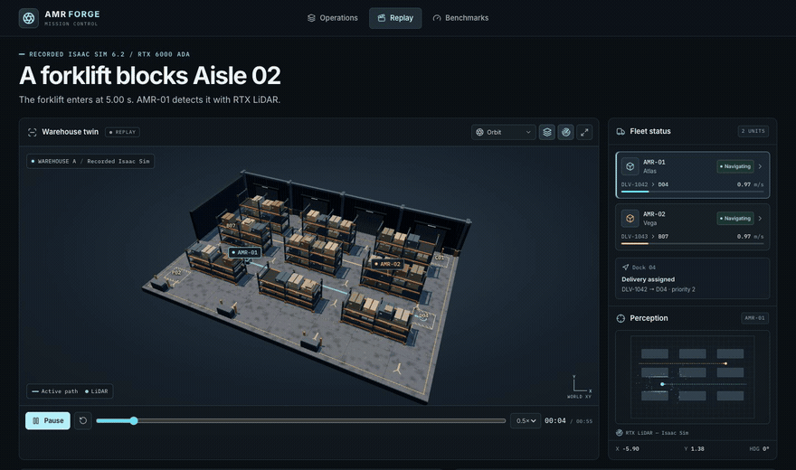
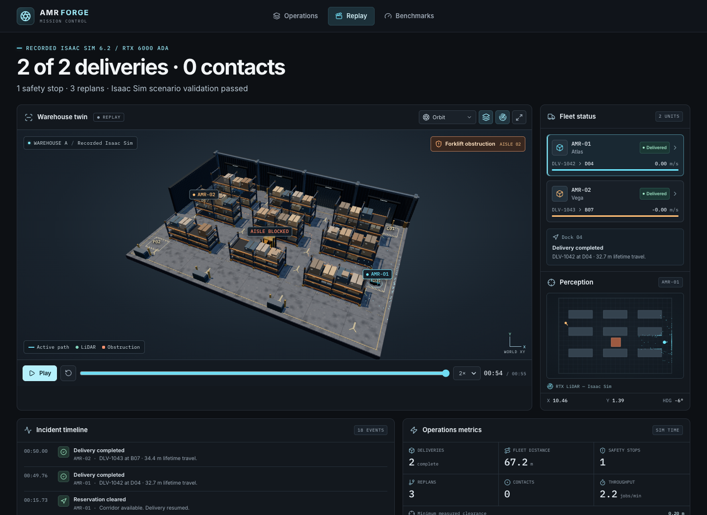

# AMR Forge · Warehouse Under Pressure

Two autonomous mobile robots share a warehouse. A forklift blocks one aisle, triggering a controlled stop, an alternate route, and a fleet traffic detour. Mission Control replays the robots’ poses, camera frames, LiDAR returns, and decisions on the same timeline.



[Watch the Isaac Sim demo (MP4)](output/playwright/isaac-sim-demo.mp4) · [Open the incident screenshot](output/playwright/isaac-incident.png)

## Verified Isaac Sim run

On **Isaac Sim 6.2.0 and an NVIDIA RTX 6000 Ada**, the 55-second scenario recorded **2/2 deliveries, 1 safety stop, 3 replans, and 0 contacts** under the scenario’s footprint metric. The run used PhysX wheel motion and captured RGB and RTX LiDAR from both robots. An offline check validated the recording and the stop-to-reroute event sequence.



## Try it locally

Use Node.js 22.18+ and a browser with WebGL.

```sh
npm ci
npm run dev
```

Open [Mission Control](http://127.0.0.1:5173) and select **Run scenario** for the interactive browser simulation. To inspect a saved Isaac Sim run, choose **Replay → Import recording** and open its JSON file.

## How it works

The Python runner builds an OpenUSD scene, applies wheel commands in PhysX, and sends measured poses and sensor samples to the TypeScript controller over a local HTTP bridge. The controller plans paths with A\* and uses traffic reservations to coordinate the fleet. The React/Three.js interface shows telemetry and replays the recorded run.

[Reproduce the Isaac Sim run](docs/runpod.md) · [Verification and tests](docs/verification.md) · [Local benchmark results](benchmarks/results/local.json)
